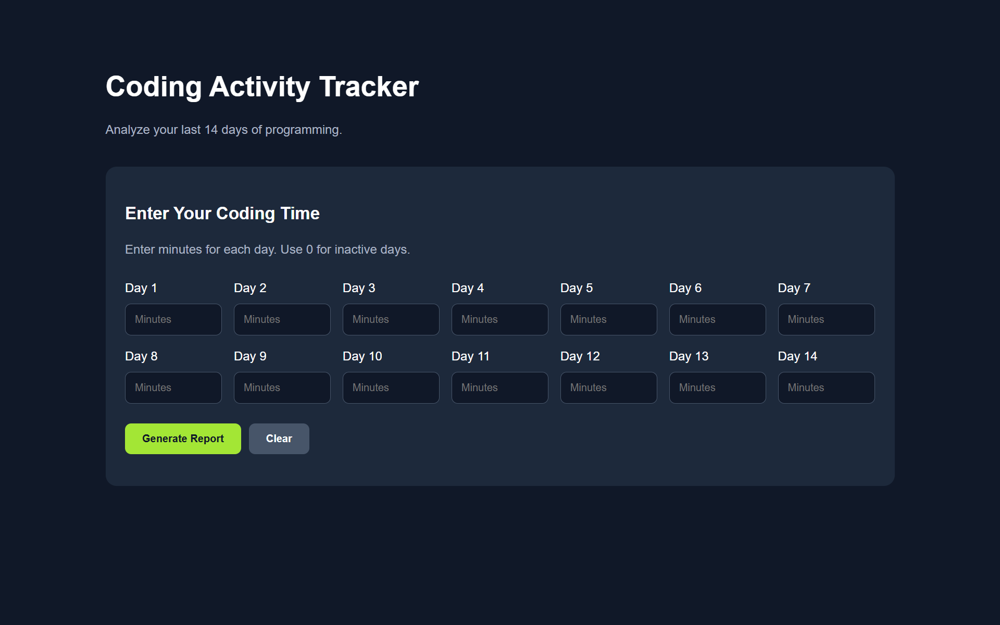
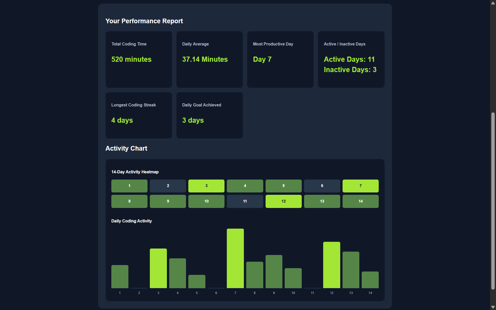

# 💻 Coding Activity Tracker

A responsive web application built with **HTML, CSS, and Vanilla JavaScript** that helps developers track their daily coding activity, analyze productivity, and visualize programming consistency over 14 days.

This project was developed to practice JavaScript fundamentals, particularly **loops, arrays, conditional statements, DOM manipulation, and event handling**, while building a functional web application.

## 📸 Screenshots

### Dashboard


### Activity Visualization


## ✨ Features

- **14-Day Activity Tracking:** Enter the number of minutes spent coding each day.
- **Total Coding Time:** Calculate total programming time across 14 days.
- **Daily Average:** Calculate the average daily coding duration.
- **Most Productive Day:** Identify the day with the highest coding time.
- **Active & Inactive Days:** Track coding consistency.
- **Longest Coding Streak:** Determine the longest sequence of consecutive active days.
- **Daily Goal Tracking:** Count the days that meet or exceed a 60-minute coding goal.
- **Activity Heatmap:** Visualize daily programming activity using color-coded squares.
- **Bar Chart:** Compare daily coding durations through dynamically generated bars.
- **Input Validation:** Prevent empty, negative, and invalid entries.
- **Responsive Design:** Adapt the interface to different screen sizes.

## 🛠️ Technologies Used

| Technology | Purpose |
|---|---|
| HTML5 | Application structure and input forms |
| CSS3 | Responsive layout, dashboard styling, and charts |
| JavaScript (ES6+) | Application logic, calculations, DOM manipulation, and event handling |
| Git & GitHub | Version control and source code management |

No external JavaScript libraries or frameworks are required.

## 📂 Project Structure

```text
coding-activity-tracker/
│
├── index.html
├── style.css
├── script.js
├── README.md
│
└── screenshots/
    ├── dashboard.png
    └── activity-chart.png
```

## 🚀 Getting Started

### 1. Clone the Repository

```bash
git clone https://github.com/EILIYA-bni/coding-activity-tracker.git
```

### 2. Open the Project

```bash
cd coding-activity-tracker
```

### 3. Run the Application

Open `index.html` in any modern web browser.

No package installation, build tools, or server configuration is required.

## 📖 How to Use

1. Open the application in your browser.
2. Enter your coding duration in minutes for each of the 14 days.
3. Enter `0` for days without coding activity.
4. Click **Generate Report**.
5. Review your productivity statistics, coding streak, heatmap, and activity bar chart.
6. Click **Clear** to reset the inputs and start again.

## 📊 Example Results

For the following sample dataset:

```javascript
const codingMinutes = [
    35, 0, 60, 45, 20, 0, 90,
    40, 50, 30, 0, 70, 55, 25
];
```

The application generates:

| Metric | Result |
|---|---|
| Total Coding Time | 520 minutes |
| Daily Average | 37.14 minutes |
| Most Productive Day | Day 7 (90 minutes) |
| Active Days | 11 |
| Inactive Days | 3 |
| Longest Coding Streak | 4 days |
| Daily Goal Achieved | 3 days |

## 🧠 JavaScript Concepts Practiced

### Loops and Iteration
Used `for` and `for...of` loops to process daily coding data, calculate statistics, and generate interface elements.

### Arrays
Stored daily programming durations in arrays and processed the values through iteration.

### Conditional Statements
Used `if/else` statements to identify active days, compare coding durations, validate inputs, and calculate streaks.

### DOM Manipulation
Used methods including:

- `document.getElementById()`
- `document.querySelectorAll()`
- `document.createElement()`
- `appendChild()`
- `textContent`

### Event Handling
Used `addEventListener()` to handle form submission and reset actions.

### Dynamic Data Visualization
Created an activity heatmap and bar chart with JavaScript and CSS, without relying on external charting libraries.

## 🎯 Project Objectives

The main objectives of this project were to:

- Strengthen JavaScript fundamentals through practical programming.
- Apply loop-based algorithms to real-world data.
- Connect JavaScript logic with HTML and CSS.
- Build an interactive, responsive user interface.
- Practice working with Git and GitHub.
- Improve problem-solving skills by implementing calculations manually.

## 🔮 Future Improvements

Potential improvements include:

- [ ] Customizable daily coding goals
- [ ] Save user data using LocalStorage
- [ ] Compare weekly coding performance
- [ ] Export productivity reports
- [ ] Support different tracking periods
- [ ] Add dark/light theme switching
- [ ] Improve accessibility and keyboard navigation
- [ ] Refactor calculation logic into reusable functions
- [ ] Add automated tests for calculation algorithms

## 👨‍💻 Author

**Eiliya Babakhani**

Self-learning programmer interested in web development, software engineering, and building practical applications.

**GitHub:** [@EILIYA-bni](https://github.com/EILIYA-bni)

---

⭐ If you find this project useful, consider giving the repository a star.

*Built with HTML, CSS, and Vanilla JavaScript as part of my programming learning journey.*